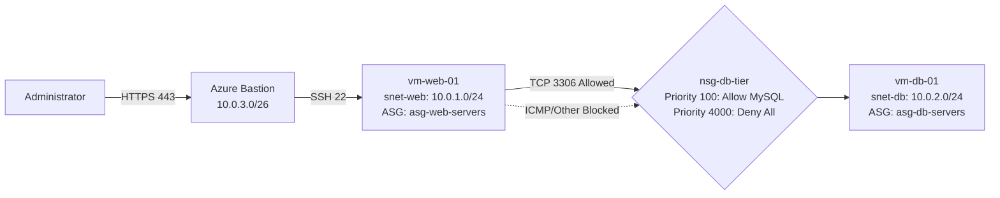

# 02 - Zero-Trust Two-Tier Virtual Network (Azure Portal / ClickOps)

## 1. Executive Summary
This project demonstrates the manual provisioning, network segmentation, and security validation of an isolated two-tier environment in Microsoft Azure using the **Azure Portal**. The architecture enforces zero-trust east-west traffic controls between a web tier and a database tier using **Network Security Groups (NSGs)** and **Application Security Groups (ASGs)**, while eliminating public IP attack surfaces via **Azure Bastion**.

---

## 2. Architecture & Design Decisions

* **Zero Public IP Exposure:** Both `vm-web-01` and `vm-db-01` (Ubuntu Linux) were provisioned with **Public IP: None**, eliminating direct internet exposure on SSH (`TCP 22`).
* **Browser-Based Jump Host:** **Azure Bastion** provides secure, encrypted SSH access over TLS (`TCP 443`) directly through the Azure Portal.
* **Role-Based Micro-Segmentation (ASGs):** Virtual machine network interfaces were mapped to `asg-web-servers` and `asg-db-servers`, decoupling firewall rules from underlying private IP addresses.
* **Explicit East-West Lockdown:** Because Azure's default `AllowVnetInBound` rule (Priority `65000`) permits all intra-VNet traffic, a custom `Deny` rule (Priority `4000`) was configured on `nsg-db-tier` to block all lateral traffic except MySQL (`TCP 3306`) from the web tier.

---

## 3. Implementation Walkthrough & Visual Evidence

### Step 1: Virtual Network & Subnet Segmentation
Provisioned `vnet-core-prod` (`10.0.0.0/16`) in **South Africa North** and segmented the address space into three isolated subnets.

| Subnet Name | CIDR Block | Assigned Resources |
| :--- | :--- | :--- |
| `snet-web` | `10.0.1.0/24` | `vm-web-01` (`10.0.1.4`) |
| `snet-db` | `10.0.2.0/24` | `vm-db-01` (`10.0.2.4`) |
| `AzureBastionSubnet` | `10.0.3.0/26` | Azure Bastion Host |

---

### Step 2: Application Security Group (ASG) Assignment
Created `asg-web-servers` and `asg-db-servers`, then attached each Ubuntu VM's primary NIC to its respective ASG under **Networking > Application security groups**.

---

### Step 3: Subnet-Level NSG Policy Enforcement
Created `nsg-web-tier` and `nsg-db-tier` and associated them directly at the **subnet level**. Configured strict inbound filtering on `nsg-db-tier`:

| Priority | Rule Name | Source | Destination | Port | Action |
| :--- | :--- | :--- | :--- | :--- | :--- |
| **100** | `Allow-Web-To-DB-SQL` | `asg-web-servers` | `asg-db-servers` | `3306` (TCP) | **Allow** |
| **4000** | `Deny-All-Other-VNet-Traffic` | `VirtualNetwork` | `Any` | `*` (Any) | **Deny** |

---

### Step 4: Secure Access via Azure Bastion
Deployed Azure Bastion into `AzureBastionSubnet` and established an authenticated browser-based SSH session to `vm-web-01` (`10.0.1.4`).

---

### Step 5: Security & Connectivity Validation
Executed network tests from `vm-web-01` targeting `vm-db-01` (`10.0.2.4`) to verify micro-segmentation:

1. **ICMP Ping Test (`ping 10.0.2.4`):** **100% Packet Loss (Blocked)** — Confirmed that Priority `4000` overrides Azure's default `AllowVnetInBound` rule and drops unauthorized protocols.
2. **MySQL Port Test (`nc -zv -w 3 10.0.2.4 3306`):** **Succeeded** — Verified against a listener on `vm-db-01` that Priority `100` evaluates first and permits TCP `3306` between `asg-web-servers` and `asg-db-servers`.

---

